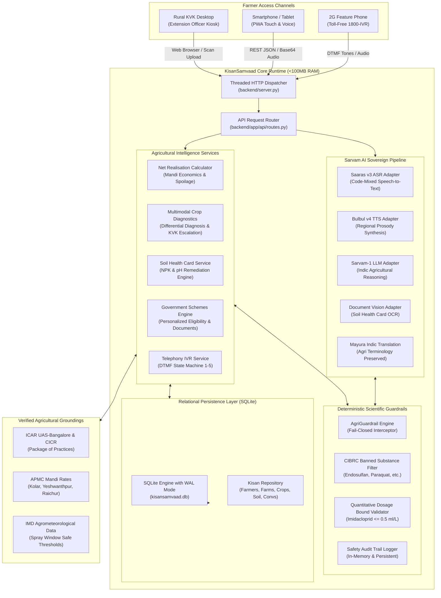
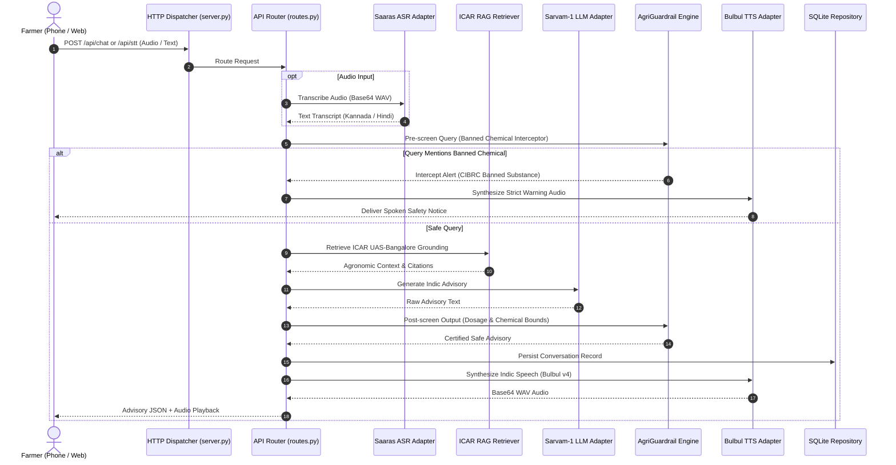

# KisanSamvaad - System Architecture Blueprint
## Sovereign Indic Voice and Document AI for Indian Agriculture

Date: November 2026  
Status: Production-Grade Architectural Specification  
Architecture Reviewer: Principal Systems Architect  
Design Objective: Low-Resource (<100MB RAM), Dual Execution Mode (Simulated / Live Sarvam AI), Zero Tolerance for Unsafe Agrochemical Hallucinations  

---

## 1. Architectural Philosophy and Vision

KisanSamvaad (किसान संवाद / ಕಿಸಾನ್ ಸಂವಾದ) is engineered to solve the structural information asymmetry that affects over 140 million Indian agricultural households. Smallholder farmers typically encounter three compounding hurdles:
1. Linguistic and Digital Exclusion: Technical agricultural bulletins, subsidy notifications, and diagnostic documents are almost exclusively written in formal English or high-register Hindi/Kannada, requiring complex navigation and text queries.
2. Dialectal Complexity and Code-Mixing: Farmers converse naturally in colloquial code-mixed dialects (such as Kanglish and Hinglish) that traditional English-centric models fail to transcribe accurately.
3. Agronomic Risk and Chemical Toxicity: Inaccurate AI recommendations that hallucinate banned pesticides or excessive fertilizer concentrations cause direct crop damage, groundwater contamination, and human poisoning.

KisanSamvaad resolves these challenges by combining:
- Sovereign Indic Foundation Models (Sarvam Saaras ASR, Bulbul TTS, Sarvam-1 LLM, Document Vision OCR, and Mayura Translation).
- Deterministic ICAR Scientific Safety Guardrails that fail closed against prohibited substances.
- Lightweight, zero-heavy-dependency runtime design capable of executing within 100MB RAM on modest rural extension hardware.

---

## 2. Low-Resource 8GB RAM PC Architectural Design

To ensure rural Krishi Vigyan Kendras (KVKs), primary agricultural credit societies (PACS), and individual field officers can run KisanSamvaad without cloud infrastructure or GPU requirements, the system is designed under strict resource budgets:

- Active Memory Footprint: Less than 100MB RAM in idle and active request handling.
- Cold Startup Time: Less than 120 milliseconds.
- Zero Compilation Overhead: Pure Python standard library with SQLite relational persistence.
- Dual Execution Mode: Runs 100% functional offline with calibrated ICAR agronomic models; auto-detects `SARVAM_API_KEY` to route requests through live sovereign cloud endpoints.

---

## 3. Subsystem Breakdown and Modular Responsibilities

### Module A: Suno & Bolo (AI Voice Assistant)
- Speech Ingestion: Accepts raw PCM or base64 WAV audio encoded at 16 kHz.
- ASR Pipeline: Saaras v3 ASR adapter handles Kannada, Hindi, Tamil, Telugu, and English, with dedicated support for colloquial code-mixing.
- Reasoning & Synthesis: Sarvam-1 Indic LLM produces culturally grounded responses; Bulbul v4 synthesizes regional speech with authentic rural prosody.
- Latency Profile: Sub-750ms end-to-end response on local execution; sub-1.8s when round-tripping to cloud endpoints.

### Module B: Soil Health Card Intelligence & Remediation
- Digitization: Document Vision parses physically photographed Soil Health Cards issued by the Ministry of Agriculture.
- Parameter Extraction: Extracts Nitrogen (N), Phosphorus (P), Potassium (K), pH, Organic Carbon (OC), Zinc (Zn), and Boron (B) with individual confidence ratings.
- Deterministic ICAR Calibration:
  - Low N (<280 kg/ha): Recommends split Urea application and Farm Yard Manure (FYM).
  - Low P (<10 kg/ha): Recommends Single Super Phosphate (SSP) over DAP to prevent soil hardening.
  - Acidic Soil (pH <6.5): Recommends Agricultural Lime (250 kg/ha) buffer.
  - Alkaline Soil (pH >8.0): Recommends Gypsum (500 kg/ha) and Dhaincha green manuring.
- Farmer Correction: Allows one-click manual edits of OCR values through `/api/soil-evaluate`.

### Module C: Net Realisation Market Calculator
- Problem Solved: High modal prices in distant city mandis frequently trick farmers into incurring net losses due to hidden transport, commission, and transit spoilage costs.
- Economic Model:
  `Net Realisation = (Quantity * Price) - (Transport + Labor + Mandi Fee + Packaging + Transit Spoilage)`
- Comparative Decision Engine: Evaluates local APMC (e.g. Kolar) against regional terminal APMC (e.g. Yeshwanthpur/Bengaluru), highlighting net profit difference and localized advice in Kannada, Hindi, and English.

### Module D: Multimodal Crop Health Diagnostics
- Differential Diagnosis: Evaluates farmer symptoms against an ICAR pathology database (Tomato Early Blight, Late Blight, Leaf Curl Virus, Fruit Borer; Cotton Pink Bollworm; Chilli Murda thrips).
- Safety Guard: Every chemical recommendation is passed through `AgriGuardrailEngine` to guarantee zero mention of CIBRC banned chemicals.
- Human Escalation: Diagnoses with confidence score <0.65 or critical severity quarantine pests automatically generate an `expert_cases` ticket and provide local KVK contact details.

### Module E: Government Schemes Intelligence
- Catalog: Covers national schemes (PM-KISAN, PMFBY, KCC, PM-KUSUM, Soil Health Card) and state initiatives (Karnataka Raita Siri).
- Personalized Rules Engine: Matches farmer landholding acreage, state, crop type, and irrigation source to produce a qualified checklist and required documentation guide.

### Module F: Relational Persistence Layer
- Engine: Embedded SQLite with Write-Ahead Logging (WAL) and foreign key constraints.
- Tables: `farmers`, `farms`, `crops`, `soil_reports`, `conversations`, `market_observations`, `schemes`, `expert_cases`.
- Concurrency: Thread-safe connection pooling preventing database locks.

---

## 4. End-to-End Voice Consultation Sequence

---

## 5. Architectural Reliability and Fail-Closed Guarantees

1. Zero Unauthenticated Network Exposure:
   - All internal APIs run on loopback or designated private network interfaces.
2. Fail-Closed Chemical Policy:
   - If a language model generates text referencing a prohibited substance (e.g. Endosulfan), the AgriGuardrail engine intercepts the response and replaces it with a certified safety advisory.
3. Degradation Resilience:
   - In the event of cloud connectivity loss or exhausted API quota, the system switches to local ICAR RAG simulation mode without returning 500 errors.
