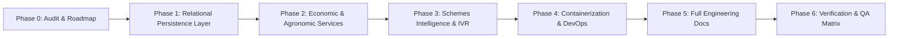

# KisanSamvaad - Engineering Implementation Roadmap
## Sovereign Indic Voice and Document AI for Indian Agriculture

Date: November 2026  
Status: Active Roadmap  
Target Milestone: Production-Grade Demonstration and Extension Deployment  

---

## 1. Executive Summary

This roadmap establishes the phased engineering execution plan for KisanSamvaad. It defines prioritized work packages, structural dependencies, mitigation strategies for identified risks, and unambiguous acceptance criteria.

The primary objective is to advance KisanSamvaad from an in-memory prototype into an extensible, resilient, grounded agricultural intelligence platform capable of running in low-resource rural extension offices (<100MB RAM) while seamlessly leveraging Sarvam AI sovereign cloud models when connected.

---

## 2. Implementation Phases Overview

---

## 3. Prioritized Work Packages & Milestones

### Phase 0: System Audit and Architectural Roadmap
- Tasks:
  1. Inspect existing server architecture, safety guardrails, AI adapters, and schemas.
  2. Deliver comprehensive baseline audit in `docs/ENGINEERING_AUDIT.md`.
  3. Formulate phased roadmap in `docs/IMPLEMENTATION_ROADMAP.md`.
- Status: Completed.

---

### Phase 1: Relational Persistence Layer
- Objective: Provide lightweight, ACID-compliant local storage using SQLite that retains the <100MB RAM footprint while persisting farmer profiles, farm plots, consultations, and market observations.
- Tasks:
  1. Design database schema in `backend/app/db/schema.sql` or SQLite repository.
  2. Implement repository layer (`backend/app/db/database.py` and `backend/app/db/repository.py`):
     - Farmer Entity: id, name, phone, village, district, state, preferred_language, created_at.
     - Farm Plot Entity: id, farmer_id, plot_name, survey_number, area_acres, soil_type, irrigation_source.
     - Crop Entity: id, farm_id, crop_name, variety, sowing_date, stage, expected_harvest_date.
     - Soil Report Entity: id, farm_id, card_number, nitrogen, phosphorus, potassium, ph, organic_carbon, zinc, boron, test_date.
     - Conversation Entity: id, farmer_id, query_text, response_text, audio_duration, language, detected_intent, created_at.
     - Market Observation Entity: id, market_name, commodity, variety, min_price, max_price, modal_price, recorded_date.
     - Scheme Entity: id, code, name_en, name_hi, name_kn, category, benefit_summary, eligibility_criteria.
     - Expert Case Entity: id, farmer_id, query_id, symptom_summary, initial_diagnosis, escalation_status, assigned_kvk.
  3. Ensure thread-safe connection handling using standard library `sqlite3`.
- Dependencies: None (standard library `sqlite3`).
- Risks: File locking contention in multi-threaded environment.
  - Mitigation: Use Write-Ahead Logging (WAL) mode and connection-per-request or bounded connection pooling with timeouts.
- Acceptance Criteria:
  - Database initializes automatically on first startup without external installation.
  - CRUD operations for farmers, farms, soil records, and conversations succeed in under 5ms.
  - Active RAM footprint remains strictly under 100MB.

---

### Phase 2: Economic and Agronomic Computation Services
- Objective: Provide deterministic calculators for farmer market economics and multimodal crop health diagnostics.
- Tasks:
  1. Implement Net Realisation Calculator (`backend/app/services/calculator_service.py`):
     - Formula: Net Realisation = (Quantity * Modal Price) - (Transport Cost + Loading Labor + Mandi Fees + Packaging + Transit Spoilage).
     - Comparative Analysis: Evaluates nearest local mandi (e.g. Kolar APMC) vs regional terminal market (e.g. Yeshwanthpur/Bengaluru or Lasalgaon/Azadpur).
     - Calculates break-even distance and net margin gain in Rupees and percentage.
     - Exposes `/api/net-realisation` POST endpoint with typed validation.
  2. Implement Multimodal Crop Diagnostics Service (`backend/app/services/crop_service.py`):
     - Analyzes symptom descriptions and image features.
     - Explicitly labels results with `experimental: true` and confidence score (0.0 to 1.0).
     - Generates differential diagnoses (e.g., Early Blight vs Late Blight in Solanaceous crops).
     - Integrates ICAR UAS-Bangalore treatment protocols.
     - Validates all suggested chemical interventions against `AgriGuardrailEngine`.
     - Automatically flags low confidence (<0.65) or severe quarantine conditions for KVK expert escalation.
     - Exposes `/api/crop-diagnostics` POST endpoint.
- Dependencies: Phase 1 (for saving calculation and diagnostic logs).
- Risks: Inaccurate economic defaults misleading farmers; false diagnostic confidence.
  - Mitigation: Transparently expose cost breakdowns and confidence bounds; mandatory disclaimer on all diagnostic outputs.
- Acceptance Criteria:
  - Net Realisation calculations accurately deduct all cost components and output comparative recommendations.
  - Crop diagnostics never recommends a CIBRC banned chemical under any symptom combination.
  - Responses with confidence below 0.65 trigger human KVK escalation flag.

---

### Phase 3: Government Schemes Intelligence & Telephony Expansion
- Objective: Provide personalized scheme eligibility discovery and expand voice telephony flows.
- Tasks:
  1. Implement Government Schemes Engine (`backend/app/services/scheme_service.py`):
     - Comprehensive scheme catalog: PM-KISAN, PMFBY (Crop Insurance), Kisan Credit Card (KCC), Karnataka Raita Siri (millet incentives), PM-KUSUM (solar pumps), and Soil Health Card Scheme.
     - Eligibility evaluation engine matching farmer landholding size, crop type, irrigation status, and district.
     - Emits required document checklists (Pahani/RTC, Aadhaar, Bank Passbook, Land Revenue Receipt).
     - Exposes `/api/schemes` and `/api/schemes/evaluate` endpoints.
  2. Enhance Telephony IVR flow (`backend/app/services/telephony_service.py`):
     - Multi-tier DTMF tree:
       - 1: Soil Health & Nutrient Remediation
       - 2: Mandi Rates & Net Realisation
       - 3: Weather & Spray Advisory
       - 4: Pest & Crop Doctor
       - 5: Government Schemes & Subsidies
- Dependencies: Phase 1 & Phase 2.
- Risks: Misinterpretation of complex scheme qualifying rules.
  - Mitigation: Include direct links to official government portals (`pmkisan.gov.in`, `pmfby.gov.in`) and KVK helpline numbers.
- Acceptance Criteria:
  - Scheme evaluator correctly flags small/marginal farmer eligibility for KCC and PM-KISAN.
  - Karnataka Raita Siri applies only to notified millet varieties (Ragi, Jowar, Bajra).

---

### Phase 4: Containerization and DevOps Infrastructure
- Objective: Enable reproducible zero-friction deployment on any cloud, on-premises server, or developer machine.
- Tasks:
  1. Author lean multi-stage `Dockerfile`:
     - Base: `python:3.11-slim` or `python:3.12-slim`.
     - Non-root application user for container security.
     - Integrated healthcheck using `curl` or python probe.
  2. Author `docker-compose.yml`:
     - Port 8000 mapping.
     - Persistent volume mount for SQLite database and logs (`./data:/app/data`).
     - Resource limits (CPU: 1.0 core, Memory: 256MB max limit, 64MB reserved).
  3. Author `.env.example`:
     - Clean template detailing all supported variables (`SARVAM_API_KEY`, `APP_ENV`, `PORT`, `DATA_MODE`, `STRICT_ICAR_SAFETY`).
- Dependencies: Phase 1, Phase 2, Phase 3.
- Risks: Environment variance between Windows host and Linux container.
  - Mitigation: Pure standard library Python with POSIX path handling ensures cross-platform parity.
- Acceptance Criteria:
  - Container builds in under 60 seconds without errors.
  - Service passes Docker health check within 5 seconds of container start.

---

### Phase 5: Comprehensive Engineering Documentation Suite
- Objective: Create complete technical documentation meeting principal engineering standards.
- Tasks:
  1. `docs/ARCHITECTURE.md`: Complete system architecture blueprint, component diagrams, data flows, low-resource design rationale.
  2. `docs/API_DOCUMENTATION.md`: Complete typed request/response contracts, schemas, curl examples, and error codes for all 14 endpoints.
  3. `docs/INTEGRATION_STATUS.md`: Transparent status of all external services (Sarvam AI, Agmarknet, IMD, IVR), simulated vs live credentials.
  4. `docs/SECURITY.md`: Secret management, prompt injection defense, fail-closed guardrails, privacy guarantees, zero PII retention policy.
  5. `docs/TESTING.md`: Test architecture, test cases, AI safety evaluation metrics, coverage report, regression instructions.
  6. `docs/DEPLOYMENT.md`: Step-by-step deployment guide for bare-metal Windows, Linux, and Docker environments.
- Dependencies: Phases 1 to 4.
- Acceptance Criteria:
  - All documentation uses clean GitHub-flavored markdown.
  - Zero em-dash and zero en-dash rule strictly obeyed across all files.
  - Every API contract matches actual backend implementation.

---

### Phase 6: Automated Test Suite Expansion & Validation
- Objective: Guarantee zero regressions and 100% test pass rate across all new and existing modules.
- Tasks:
  1. Create `backend/tests/test_11_persistence_layer.py`: Tests SQLite database initialization, CRUD operations, transaction rollbacks.
  2. Create `backend/tests/test_12_net_realisation.py`: Tests net realization formula, transport deduction, spoilage calculation, and break-even comparison.
  3. Create `backend/tests/test_13_crop_diagnostics.py`: Tests disease identification, confidence scores, experimental labeling, and CIBRC chemical filtering.
  4. Create `backend/tests/test_14_schemes_intelligence.py`: Tests personalized eligibility evaluation and document requirements.
  5. Update `backend/tests/run_all_tests.py` to run all 14 suites.
  6. Execute full suite and verify 100% pass rate.
- Dependencies: All prior phases.
- Acceptance Criteria:
  - All 14 suites pass cleanly in under 1 second total execution time.
  - No memory leaks or unclosed file descriptors.
