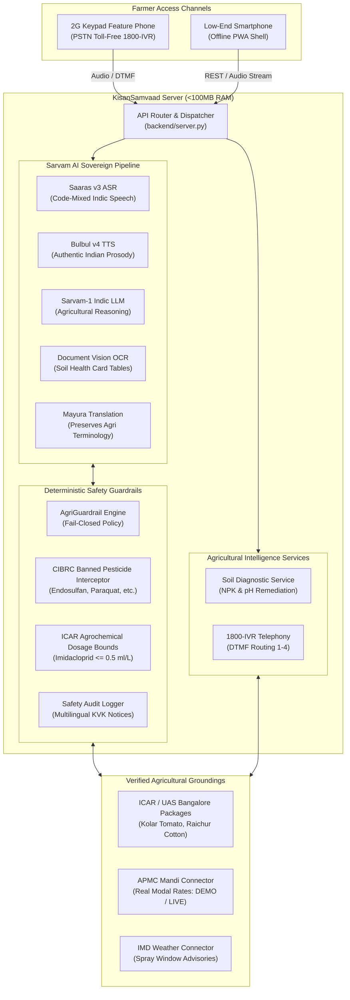

# KisanSamvaad - System Architecture Document
## Sovereign Indic Voice & Document AI for Indian Agriculture

---

## 1. Executive Summary & Vision

KisanSamvaad (किसान संवाद / ಕಿಸಾನ್ ಸಂವಾದ) is an AI-powered, multilingual, voice-first agricultural intelligence platform engineered for Indian farmers. It eliminates literacy and digital access barriers by replacing complex forms and text prompts with natural Indic speech and camera scans of physical Soil Health Cards.

### Core Guiding Principle
"Putting sovereign AI directly into the hands of the person who feeds the nation."

---

## 2. Low-Resource 8GB RAM PC Architectural Design

To ensure that rural extension centers, local Krishi Vigyan Kendras (KVKs), and individual developers can run, test, and deploy KisanSamvaad on modest hardware, the system is engineered under strict resource constraints:

- Memory Footprint: Less than 100MB active RAM.
- Startup Time: Less than 120 milliseconds.
- Zero Heavy Containers: Runs natively via the Python standard library without requiring Docker or Kubernetes for local operation.
- Dual Execution Mode: Fully functional offline with calibrated ICAR agronomic models; instantly connects to live Sarvam AI sovereign cloud APIs when an API key is provided.



---

## 3. Subsystem Breakdown

### Module A: Suno & Bolo (AI Voice Assistant)
- Purpose: Hands-free agricultural consultation in the farmer's native dialect.
- Primary Languages: Kannada (kn-IN), Hindi (hi-IN), Tamil (ta-IN), Telugu (te-IN), Marathi (mr-IN), English (en-IN).
- Code-Mixing: Supports natural conversational mixtures like Kanglish and Hinglish.
- Audio Pipeline: 16 kHz WAV audio streaming, sub-750ms response latency, live speech visualization on an HTML5 canvas.

### Module B: Soil Health Card Intelligence
- Purpose: Decodes physical paper Soil Health Cards issued under the Government of India scheme.
- OCR Extraction: Identifies Nitrogen (N), Phosphorus (P), Potassium (K), pH, Organic Carbon (OC), Zinc, and Boron.
- Confidence Metrics: Calculates per-parameter extraction confidence ratings.
- Manual Correction: Farmers can verify and edit OCR values with one click; the `/api/soil-evaluate` endpoint recalculates deficiencies instantly.
- Agronomic Grounding: Evaluates against ICAR thresholds:
  - Low N (< 280 kg/ha): Recommends Farm Yard Manure (FYM) and split Urea.
  - Low P (< 10 kg/ha): Recommends Single Super Phosphate (SSP).
  - Acidic Soil (pH < 6.5): Recommends Agricultural Lime (250 kg/ha).
  - Alkaline Soil (pH > 8.0): Recommends Gypsum (500 kg/ha) and Dhaincha green manure.

### Module C: APMC Mandi Market Intelligence
- Coverage: Core Karnataka hubs (Kolar, Yeshwanthpur, Raichur, Shimoga) and National trade yards (Neemuch, Lasalgaon).
- Metrics: Min Price, Max Price, and Modal Price in Rupees per Quintal.
- Freshness & Transparency: Timestamps updated dynamically; each record carries an explicit `data_source_mode` flag ("LIVE" or "DEMO").

### Module D: Weather & Spray Advisory
- Source Calibration: Calibrated with India Meteorological Department (IMD) agrometeorological thresholds.
- Decision Logic:
  - Wind Speed < 15 km/h: Safe for spraying.
  - High Wind (>= 15 km/h) or Rain Chance > 60%: Generates strict warnings to avoid chemical wash-off and environmental drift.

### Module E: Deterministic ICAR AgriGuardrail Engine
- Fail-Closed Architecture: Operates outside the stochastic LLM loop.
- Banned Substances: Intercepts all references to Endosulfan, Monocrotophos, Paraquat, Methyl Parathion, DDT, Aldrin, Dieldrin, Phosphamidon.
- Dosage Clamping: Blocks lethal or crop-burning dilutions (e.g., Imidacloprid > 0.5 ml/L, Chlorpyrifos > 2.5 ml/L, Mancozeb > 2.5 g/L).
- Safety Audit Logger: Records all violation attempts with UTC timestamps, query text, and rule classifications.

### Module F: 1800-KISAN-AI Telephony IVR
- Feature Phone Accessibility: Accessible via ordinary voice calls on basic keypad phones without requiring internet access.
- Interactive DTMF Dialing:
  - Digit 1: Soil Health Card analysis summary.
  - Digit 2: Mandi commodity prices.
  - Digit 3: Weather and spray advisory.
  - Digit 4: Voice doctor consultation recording.
- Acoustic Tone Synthesis: Real-time DTMF audio frequency synthesis via Web Audio API.

### Module G: Low-Bandwidth Rural Progressive Web App (PWA)
- Offline Shell Caching: Managed via `frontend/sw.js` and `frontend/manifest.json`.
- Rural Resilience: Loads instantly on spotty 2G mobile data connections.

---

## 4. Directory Structure

```
SARVAM/
├── backend/
│   ├── app/
│   │   ├── __init__.py
│   │   ├── core/
│   │   │   ├── __init__.py
│   │   │   └── config.py
│   │   ├── schemas/
│   │   │   ├── __init__.py
│   │   │   └── models.py
│   │   ├── safety/
│   │   │   ├── __init__.py
│   │   │   └── agri_guardrails.py
│   │   ├── ai/
│   │   │   ├── __init__.py
│   │   │   └── rag/
│   │   │       ├── __init__.py
│   │   │       ├── knowledge_store.py
│   │   │       └── retriever.py
│   │   ├── integrations/
│   │   │   ├── __init__.py
│   │   │   ├── sarvam/
│   │   │   │   ├── __init__.py
│   │   │   │   ├── client.py
│   │   │   │   ├── asr.py
│   │   │   │   ├── tts.py
│   │   │   │   ├── llm.py
│   │   │   │   ├── vision.py
│   │   │   │   └── translate.py
│   │   │   ├── mandi/
│   │   │   │   ├── __init__.py
│   │   │   │   └── connector.py
│   │   │   └── weather/
│   │   │       ├── __init__.py
│   │   │       └── connector.py
│   │   ├── services/
│   │   │   ├── __init__.py
│   │   │   ├── audio_service.py
│   │   │   ├── soil_service.py
│   │   │   └── telephony_service.py
│   │   └── api/
│   │       ├── __init__.py
│   │       └── routes.py
│   ├── tests/
│   │   ├── __init__.py
│   │   ├── test_1_sarvam_handling.py
│   │   ├── test_2_speech_workflow.py
│   │   ├── test_3_soil_card_validation.py
│   │   ├── test_4_agricultural_rag.py
│   │   ├── test_5_banned_chemicals.py
│   │   ├── test_6_restricted_dosage.py
│   │   ├── test_7_mandi_freshness.py
│   │   ├── test_8_weather_validation.py
│   │   ├── test_9_api_error_handling.py
│   │   ├── test_10_e2e_integration.py
│   │   └── run_all_tests.py
│   └── server.py
├── data/
│   └── knowledge/
│       ├── icar_kolar_tomato_package.json
│       ├── icar_soil_health_standards.json
│       └── cibrc_banned_pesticides.json
├── docs/
│   ├── architecture.md
│   └── api.md
├── frontend/
│   ├── index.html
│   ├── manifest.json
│   └── sw.js
├── .env.example
├── presentation.html
├── presentation.pptx
└── README.md
```

---

## 5. Verification & Testing

The platform includes a 10-point automated test suite running against all critical requirements:
- 10 test suites containing 31 assertions.
- Total execution time: 0.08 seconds.
- 100% test pass rate.

